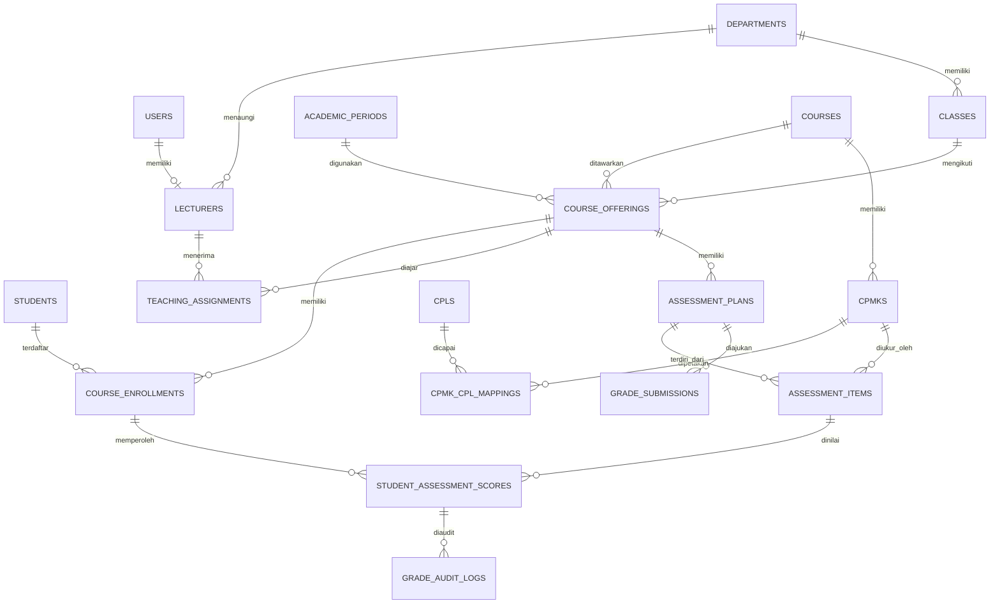

# Diagram Relasi Penilaian Dosen

Diagram berikut menggambarkan hubungan data yang direncanakan. Ini adalah desain konseptual, bukan migration yang sudah diterapkan.



## Alur Data

```text
Admin membuat kelas dan penawaran mata kuliah
    -> admin mendaftarkan peserta
    -> admin menugaskan dosen
    -> admin membuat CPMK dan pemetaan CPL
    -> admin membuat rencana dan item penilaian
    -> sistem memvalidasi total bobot 100%
    -> rencana dipublikasikan
    -> dosen mengisi skor
    -> sistem menghitung nilai akhir, CPMK, dan CPL
    -> dosen mengajukan
    -> koordinator menyetujui
    -> nilai dikunci
```

## Batas Keamanan Utama

`course_offering_id` menjadi batas utama akses dosen. Seluruh permintaan skor harus ditelusuri melalui penugasan dosen pada penawaran mata kuliah tersebut. Identitas `student_id`, `course_id`, atau `class_id` dari frontend tidak boleh dipercaya tanpa pemeriksaan relasi di backend.
